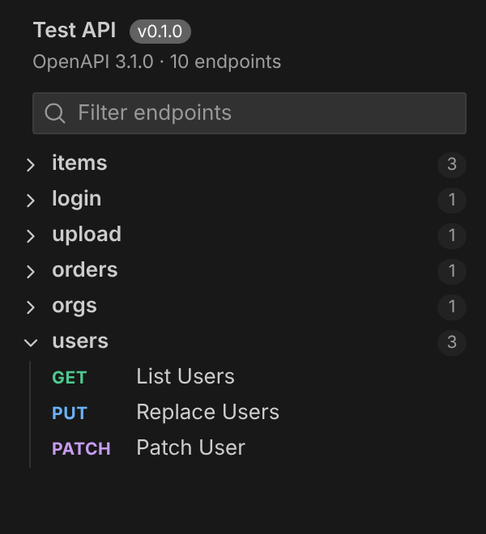
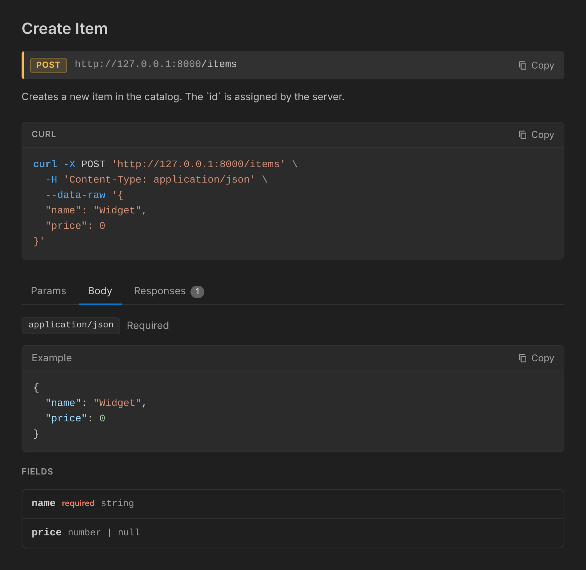

# Spec Renderer

Browse an **OpenAPI** or **Swagger** spec from the VS Code Activity Bar and copy
ready-to-run **cURL** commands without leaving the editor.

<p>
  
  
</p>

## Features

- **Modules → endpoints.** Endpoints are grouped by tag. Untagged endpoints are
  grouped by their first path segment (`/items/{id}` → `items`).
- **One details tab.** Clicking an endpoint opens its details beside your code.
  Clicking another endpoint replaces the contents of the same tab.
- **cURL commands.** Generated from examples and schemas, with file uploads
  (`-F file=@…`), form bodies and auth placeholders (`Bearer <token>`,
  `<api-key>`).
- **Params, body and responses.** Field types, required flags, and examples for
  each status code.
- **Point it at a docs page.** `http://localhost:8000/docs` (FastAPI),
  `/swagger-ui/index.html` (Spring) and similar pages work; the spec URL is found
  automatically.
- **Forgiving.** Specs with minor validation errors still load with a warning.
  A failed refresh keeps the last good spec.
- **Keyboard and theme friendly.** Arrow keys move through the tree, and the UI
  follows your colour theme, including light and high-contrast themes.

### Supported specs

| Format        | Versions   | Encoding    |
| ------------- | ---------- | ----------- |
| OpenAPI       | 3.0, 3.1   | JSON, YAML  |
| Swagger       | 2.0        | JSON, YAML  |

## Getting started

1. Open the **Spec Renderer** view in the Activity Bar.
2. Click **Set Spec URL**, or the link icon in the view's title bar, and enter a
   URL, for example `http://127.0.0.1:8000/openapi.json`.
3. Expand a module and click an endpoint.

The URL is saved in the `specRenderer.specUrl` setting. When a folder is open
it is saved to the workspace, so each project keeps its own spec.

| Setting                 | Description                                         |
| ----------------------- | --------------------------------------------------- |
| `specRenderer.specUrl`  | URL of the spec, or of a docs page that links to it. |

| Command                              | Where                  |
| ------------------------------------ | ---------------------- |
| Spec Renderer: Set Spec URL          | View title bar, palette |
| Spec Renderer: Refresh Spec          | View title bar, palette |
| Spec Renderer: Collapse All Modules  | View title bar, palette |

Spec Renderer displays specs and generates commands. It never sends requests to
your API.

## Development

```sh
npm install
npm run build      # bundle to dist/ (use `npm run watch` while developing)
npm test           # unit tests for the spec pipeline
npm run typecheck  # extension + webview type checks
```

Press **F5** in VS Code to launch an Extension Development Host.

### Project layout

```
src/
  extension.ts          activate(): wires store, views and commands
  config.ts             specRenderer.* settings
  specStore.ts          loaded spec + loading / error state
  spec/                 pure TypeScript, no vscode imports, unit-tested
    loader.ts           download + docs-page discovery
    parser.ts           JSON/YAML, validation, $ref resolution
    normalize.ts        OpenAPI 3 / Swagger 2 → one internal model
    catalog.ts          modules and endpoint list
    details.ts          view model for one endpoint
    curl.ts             cURL builder
    sample.ts           example values from schemas
    model.ts            types
  shared/protocol.ts    messages between extension and webviews
  views/
    sidebarView.ts      Activity Bar webview (module tree)
    endpointPanel.ts    single reusable details tab
    webviewHtml.ts      HTML shell + Content Security Policy
  webview/              browser code, bundled by esbuild
    sidebar/            tree UI
    panel/              endpoint details UI
    shared/             DOM helpers, theme tokens
media/                  Activity Bar, tab and Marketplace icons
test/                   node:test suites
```

Publishing steps are in [docs/PUBLISHING.md](docs/PUBLISHING.md).

## License

[MIT](LICENSE)
